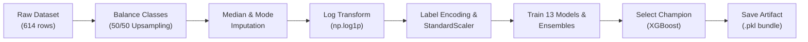

# 🏦 LoanTrack — Intelligent Loan Eligibility & Bank Recommendation System

[](https://www.python.org/)
[](https://fastapi.tiangolo.com/)
[](https://xgboost.readthedocs.io/)
[](https://scikit-learn.org/)
[](https://www.docker.com/)
[](https://opensource.org/licenses/MIT)

**LoanTrack** is an end-to-end Machine Learning web application and REST API that predicts loan eligibility and recommends optimal bank loan offers. It benchmarks **13 Machine Learning algorithms** (including tree ensembles, neural networks, and soft voting classifiers), ultimately deploying a high-precision **XGBoost** model paired with an interactive **glassmorphism Web UI** and a high-performance **FastAPI** backend.

---

## 🌟 Key Features

- **🧠 13 Machine Learning Models Evaluated**: Comprehensive benchmark including Logistic Regression, Decision Tree, Random Forest, Extra Trees, SVM, KNN, Gaussian Naive Bayes, AdaBoost, Gradient Boosting, MLP Neural Network, XGBoost, and 2 Voting Ensembles.
- **⚡ Production-Ready XGBoost Engine**: Champion model serialized with pre-fitted `StandardScaler` and `LabelEncoder` pipelines to guarantee zero training-serving skew.
- **🎨 Glassmorphism Web Interface**: Dark-themed responsive interface featuring real-time input formatting in Indian Rupees (₹ INR), animated probability meters, and instant eligibility verdicts.
- **🏦 Intelligent Bank Recommender**: Dynamically suggests top partner bank loan products (SBI, HDFC, ICICI, Axis, Bank of Baroda) based on applicant risk profile and loan amounts.
- **📡 RESTful API**: Built with FastAPI, complete with automatic interactive documentation (Swagger UI / OpenAPI).
- **🧪 100% Tested**: Automated unit and integration test suite via `pytest`.
- **🐳 Containerized**: Single-command deployment using Docker.

---

## 📁 Repository Structure

```
.
├── LoanTrack/                     # 🚀 Production Application
│   ├── app/                       # Web service & UI assets
│   │   ├── main.py                # FastAPI endpoints & route handlers
│   │   ├── schemas.py             # Pydantic input/output validation schemas
│   │   └── static/                # Frontend assets
│   │       ├── index.html         # Glassmorphism user interface
│   │       ├── style.css          # CSS styles & animations
│   │       └── app.js             # Client-side validation & API integration
│   ├── config/                    # Configuration management
│   │   └── settings.py            # Centralized hyperparams, paths & feature lists
│   ├── data/                      # Dataset repository
│   │   └── loan_data.csv          # Kaggle Loan Prediction Dataset (614 rows)
│   ├── models/                    # Serialized model artifacts (.pkl binaries)
│   │   └── xgboost_loan_model.pkl # Best production model
│   ├── visualizations/            # Output charts & evaluation figures
│   │   ├── accuracy_comparison.png
│   │   ├── roc_curves.png
│   │   └── confusion_matrix.png
│   ├── src/loan_ml/               # Modular Python ML package
│   │   ├── data/loader.py         # Data loading & minority class upsampling
│   │   ├── preprocessing/pipeline.py # Imputation, log transform, encoding, scaling
│   │   ├── training/              # Model training & evaluation routines
│   │   │   ├── trainer.py         # 13 ML models + ensemble construction
│   │   │   └── evaluator.py       # Metrics scoring (Accuracy, F1, ROC-AUC)
│   │   ├── plotting/plots.py      # Plotting functions (headless Matplotlib/Seaborn)
│   │   └── inference/predictor.py # Model persistence and single-applicant prediction
│   ├── tests/                     # Automated test suite
│   │   ├── test_preprocessing.py  # Data pipeline unit tests
│   │   └── test_inference.py      # End-to-end prediction integration tests
│   ├── cli.py                     # Unified CLI runner (serve, predict, train)
│   ├── train.py                   # Automated ML pipeline execution script
│   ├── requirements.txt           # Production dependencies
│   ├── setup.py                   # Package installation configuration
│   └── Dockerfile                 # Container specification
│
├── legacy_experiments/            # 🧪 Archived Initial Research
│   ├── notebooks/                 # Original exploratory Jupyter notebook
│   ├── scripts/                   # Monolithic prototype scripts
│   ├── models/                    # Early experiment model checkpoints
│   └── plots/                     # Initial benchmark plots
│
└── project_explanation.md         # 📖 Detailed Architectural Deep Dive
```

---

## 🚀 Quick Start

### 1. Clone the Repository

```bash
git clone https://github.com/dy2080/LoanTrack.git
cd LoanTrack/LoanTrack
```

### 2. Set Up Virtual Environment

```bash
# Windows
python -m venv venv
.\venv\Scripts\activate

# macOS / Linux
python3 -m venv venv
source venv/bin/activate
```

### 3. Install Dependencies

```bash
pip install -r requirements.txt
```

### 4. Launch the Application

```bash
python cli.py serve
```

Open your browser at **[http://localhost:8000](http://localhost:8000)** to access the Web UI.

---

## 🖥️ Command-Line Interface (CLI)

LoanTrack includes a unified CLI for training, inference, and serving:

| Command | Action |
| :--- | :--- |
| `python cli.py serve` | Starts the FastAPI server on port 8000 |
| `python cli.py serve --port 5000` | Starts the server on a custom port |
| `python cli.py predict` | Runs demo inference on a sample applicant |
| `python cli.py train` | Trains all 13 models with log transformation |
| `python cli.py train --both` | Trains and evaluates models both with & without log transform |

---

## 🧪 Running Tests

LoanTrack includes a comprehensive automated test suite powered by `pytest`:

```bash
pytest tests/ -v
```

Expected output:
```text
tests/test_inference.py::TestInference::test_predict_returns_dict PASSED
tests/test_inference.py::TestInference::test_status_values PASSED
tests/test_inference.py::TestInference::test_probability_range PASSED
tests/test_preprocessing.py::TestPreprocessing::test_no_missing_after_imputation PASSED
tests/test_preprocessing.py::TestPreprocessing::test_output_shapes PASSED
tests/test_preprocessing.py::TestPreprocessing::test_label_encoders_created PASSED
tests/test_preprocessing.py::TestPreprocessing::test_scaler_fitted PASSED

======================= 7 passed in 18.40s =======================
```

---

## 🌐 API Reference

### Health Check

```http
GET /health
```

**Response (`200 OK`)**:
```json
{
  "status": "ok",
  "model_loaded": true
}
```

---

### Predict Loan Eligibility

```http
POST /predict
Content-Type: application/json
```

**Request Payload**:
```json
{
  "Gender": "Male",
  "Married": "Yes",
  "Dependents": "1",
  "Education": "Graduate",
  "Self_Employed": "No",
  "ApplicantIncome": 5000,
  "CoapplicantIncome": 2000,
  "LoanAmount": 150,
  "Loan_Amount_Term": 360,
  "Credit_History": 1.0,
  "Property_Area": "Urban"
}
```

**Response (`200 OK`)**:
```json
{
  "status": "APPROVED",
  "probability": 0.7509,
  "probability_pct": "75.1%"
}
```

Interactive documentation is available at **[http://localhost:8000/docs](http://localhost:8000/docs)** (Swagger UI) and **[http://localhost:8000/redoc](http://localhost:8000/redoc)**.

---

## 📊 Machine Learning Pipeline



### Models Evaluated

1. Logistic Regression
2. Decision Tree Classifier
3. Random Forest Classifier
4. Extra Trees Classifier
5. Support Vector Classifier (RBF Kernel)
6. K-Nearest Neighbors Classifier
7. Gaussian Naive Bayes
8. AdaBoost Classifier
9. Gradient Boosting Classifier
10. Multi-Layer Perceptron (Neural Network)
11. **XGBoost Classifier** ⭐ *(Best performing)*
12. Voting Ensemble 1 (Soft vote across all 11 models)
13. Voting Ensemble 2 (Soft vote across top 3 boosters)

---

## 🐳 Docker Deployment

Build and run the containerized application:

```bash
# Build the Docker image
docker build -t loantrack LoanTrack

# Run the container
docker run -p 8000:8000 loantrack
```

Access the application at `http://localhost:8000`.

---

## 👥 Contributing

1. Fork the Project
2. Create your Feature Branch (`git checkout -b feature/AmazingFeature`)
3. Commit your Changes (`git commit -m 'Add some AmazingFeature'`)
4. Push to the Branch (`git push origin feature/AmazingFeature`)
5. Open a Pull Request

---

## 📄 License

Distributed under the MIT License. See `LICENSE` for more information.
