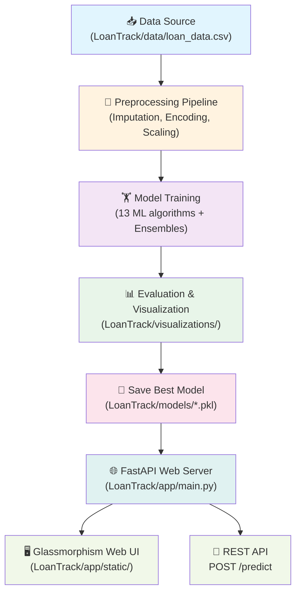

# 🏦 LoanTrack — Loan Eligibility Prediction System — Architecture & Guide

## Overview

**LoanTrack** is an **end-to-end Machine Learning system** that predicts whether a loan application will be **APPROVED** or **REJECTED**, based on 11 applicant features (income, education, credit history, loan amount, etc.). It benchmarks **13 ML algorithms** on the Kaggle Loan Prediction Dataset, deploying the top-performing model (**XGBoost**) behind a FastAPI REST API and a glassmorphism Web UI.

---

## 📁 Workspace Organization

The workspace is organized into two distinct zones:

```
c:\ml new model\
├── LoanTrack/              # 🚀 Modern Production Project (API, UI, Modular ML, Tests)
├── legacy_experiments/     # 🧪 Archived Exploratory Notebooks & Prototyping Scripts
└── project_explanation.md  # 📖 System Architecture & Guide
```

### LoanTrack Project Structure

```
LoanTrack/
├── app/                          # Web server & frontend
│   ├── main.py                   # FastAPI REST API & route handlers
│   ├── schemas.py                # Pydantic data schemas
│   └── static/                   # Glassmorphism UI (index.html, style.css, app.js)
├── config/
│   └── settings.py               # Centralized configuration & file paths
├── data/
│   ├── loan_data.csv             # Kaggle dataset
│   └── README.md
├── models/                       # Saved binary model artifacts (.pkl files)
│   ├── xgboost_loan_model.pkl
│   └── README.md
├── visualizations/               # Generated evaluation plots (.png images)
│   └── README.md
├── src/loan_ml/                  # Core Python ML source code
│   ├── data/loader.py            # Data loading & minority class upsampling
│   ├── preprocessing/pipeline.py # Imputation, log transform, encoding, scaling
│   ├── training/                 # ML model training & evaluation routines
│   │   ├── trainer.py            # 13 ML models + ensemble setup
│   │   └── evaluator.py          # Metric scoring & summary tables
│   ├── plotting/                 # Chart generation routines
│   │   └── plots.py              # Bar charts, ROC curves, confusion matrices
│   └── inference/predictor.py    # Prediction pipeline & artifact loader
├── tests/                        # Automated unit & integration tests
├── cli.py                        # Unified CLI runner (train/predict/serve)
├── train.py                      # Training pipeline execution script
├── requirements.txt              # Project Python dependencies
├── setup.py                      # Package installation config
├── Dockerfile                    # Container definition
└── README.md                     # Project documentation
```

---

## 🏛️ System Architecture



---

## Step-by-Step Data Flow

### 1️⃣ Data Loading — [`loader.py`](file:///c:/ml%20new%20model/LoanTrack/src/loan_ml/data/loader.py)

| Function | Description |
|---|---|
| [`load_dataset()`](file:///c:/ml%20new%20model/LoanTrack/src/loan_ml/data/loader.py) | Loads CSV from local `data/loan_data.csv`; falls back to remote URL if missing |
| [`balance_dataset()`](file:///c:/ml%20new%20model/LoanTrack/src/loan_ml/data/loader.py) | Balances class imbalance (minority upsampling to 50/50 split) |

### 2️⃣ Preprocessing — [`pipeline.py`](file:///c:/ml%20new%20model/LoanTrack/src/loan_ml/preprocessing/pipeline.py)

1. **Balance Target**: Resamples minority class to achieve 50/50 split.
2. **Missing Value Imputation**: Median for numeric fields, mode for categorical fields.
3. **Log Transformation**: Applies `log1p` to skewed continuous numeric features.
4. **Label Encoding**: Encodes categorical values into numerical labels.
5. **Standard Scaling**: Centers and standardizes continuous features.
6. **Stratified Split**: 80/20 train/test split preserving class distribution.

### 3️⃣ Model Training — [`trainer.py`](file:///c:/ml%20new%20model/LoanTrack/src/loan_ml/training/trainer.py)

Trains **13 algorithms**:
1. Logistic Regression
2. Decision Tree
3. Random Forest
4. Extra Trees
5. SVM (RBF Kernel)
6. K-Nearest Neighbors
7. Gaussian Naive Bayes
8. AdaBoost
9. Gradient Boosting
10. Multi-Layer Perceptron (Neural Network)
11. **XGBoost** ⭐ *(Best overall performance)*
12. Voting Ensemble 1 (Soft vote across all models)
13. Voting Ensemble 2 (Soft vote across top 3 boosters)

### 4️⃣ Evaluation — [`evaluator.py`](file:///c:/ml%20new%20model/LoanTrack/src/loan_ml/training/evaluator.py)

Scores each model on Accuracy, Precision, Recall, F1 Score, and ROC AUC, selecting the champion model.

### 5️⃣ Visualization — [`plots.py`](file:///c:/ml%20new%20model/LoanTrack/src/loan_ml/plotting/plots.py)

Outputs headless PNG figures into [`LoanTrack/visualizations/`](file:///c:/ml%20new%20model/LoanTrack/visualizations/):
- Accuracy comparison across all 13 algorithms
- Confusion matrix heatmap for XGBoost
- Multi-model ROC curves with AUC values

### 6️⃣ Inference & Model Serialization — [`predictor.py`](file:///c:/ml%20new%20model/LoanTrack/src/loan_ml/inference/predictor.py)

Bundles the trained model, fitted `StandardScaler`, and `LabelEncoder` objects into `models/xgboost_loan_model.pkl`.

---

## 🖥️ Running LoanTrack

Navigate to `LoanTrack`:
```bash
cd LoanTrack
```

| Action | Command |
| :--- | :--- |
| **Launch Web UI & REST API** | `python cli.py serve` |
| **Run Demo Inference** | `python cli.py predict` |
| **Re-train ML Pipeline** | `python cli.py train` |
| **Execute Test Suite** | `pytest tests/ -v` |
